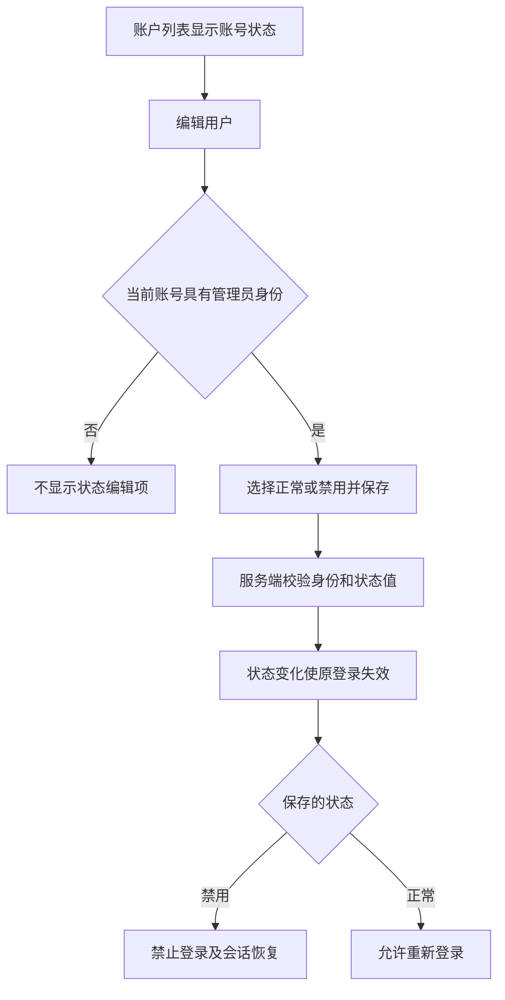
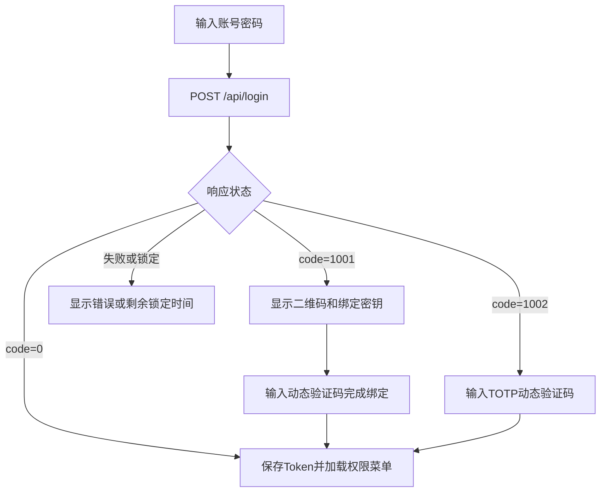
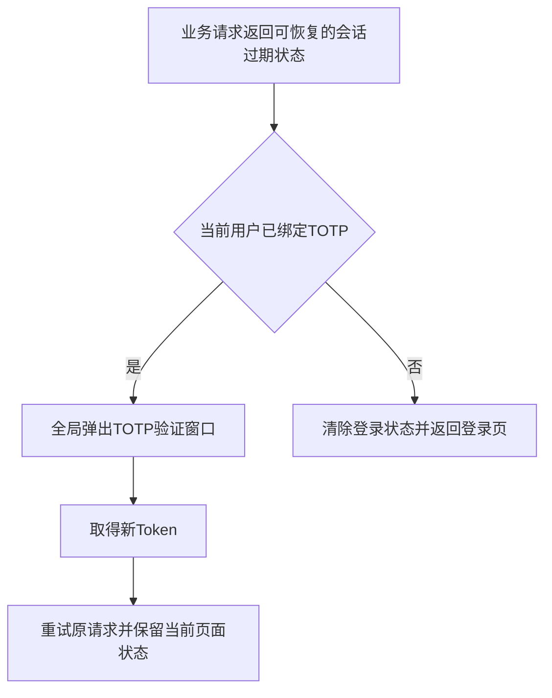
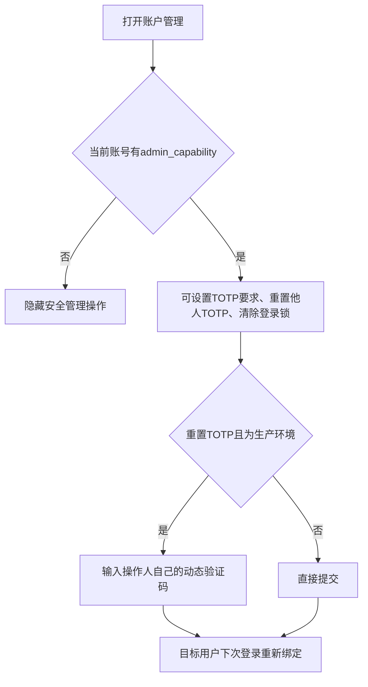
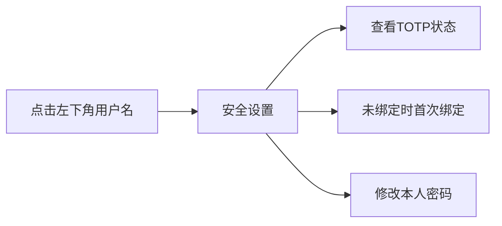

# 系统用户管理业务流程图解

## 管理员编辑账号状态

## 最后登录与软删除

- 完成密码登录或 TOTP 登录后，后端更新最后登录 IP 和时间，列表重新查询时回显。
- 删除确认提示“删除后，该账号将无法登录，也无法在账号列表中查询到。”；成功后刷新列表，已删除账号不再展示且原登录失效。

## 登录分流

## 会话过期恢复

## 管理员重置与清锁

## 本人安全设置

